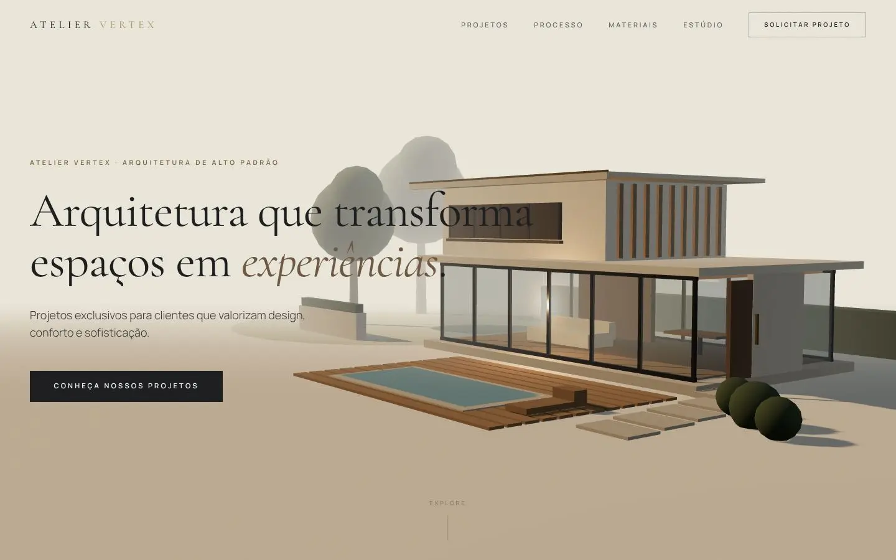

**English** | [Português](README.pt-BR.md)

# ATELIER VERTEX

Concept website for a high-end architecture studio. The brand is fictional: the projects, testimonials, address and contact details on the site are illustrative (the e-mail uses a reserved `.example` domain). Portfolio project by [MilWeb](https://milweb.com.br). The site content is in Brazilian Portuguese.

> **Type:** concept (fictional brand, portfolio project)

This is the first version. The rebuilt version lives in [atelier-vertex-v2](https://github.com/rickjs2005/atelier-vertex-v2).



## Features

- Hero with a procedural 3D house (React Three Fiber), no external 3D models.
- Manifesto, projects, process, materials, differentials, testimonials and contact sections, with scroll animations (GSAP and Framer Motion) and smooth scrolling (Lenis).
- Detail page for each of the six projects at `/projetos/[slug]`, statically generated from `src/lib/projects.ts`.
- `sitemap.xml` and `robots.txt` generated by the App Router.

## Stack

Next.js 15.5 (App Router, Turbopack), React 19.1, TypeScript 5, Tailwind CSS 4, Three.js 0.185 with React Three Fiber 9 and drei 10, GSAP 3, Lenis, Framer Motion 12. Cormorant Garamond and Manrope fonts via `next/font/google`.

## Getting started

Prerequisites: Node.js 20 or newer and npm.

```bash
npm ci
npm run dev      # development server (http://localhost:3000)
```

### Scripts

| Script | What it does |
| --- | --- |
| `npm run dev` | development server with Turbopack |
| `npm run build` | production build |
| `npm run start` | serves the build |
| `npm run lint` | ESLint |

There are no environment variables. Brand data (name, URL, e-mail) lives in `src/lib/site.ts`. The URL configured there (`atelier-vertex.vercel.app`) is used for metadata, `sitemap` and `robots`; there is no confirmed published demo of this version.

## Structure

```
src/
  app/                 layout, home page, /projetos/[slug], sitemap, robots
  components/          nav, footer, cursor, loader, smooth scroll
    sections/          home page sections
    three/             hero 3D scene
  hooks/               gate that decides whether the 3D scene loads
  lib/                 brand data, projects and GSAP setup
```

## Limitations

- The 3D scene (and three.js itself) only loads on desktop: viewport of 1024px or wider, fine pointer and no reduced-motion preference. Mobile devices get no WebGL.
- Static, fictional content; no back end and no form: the contact button opens a `mailto:` link to a `.example` address.
- Project photos are loaded at runtime from `images.unsplash.com` (allowed in `next.config.ts`); they do not show without internet access.
- No automated tests; CI runs lint, type checking and the build.

## Credits

- Project photos: [Unsplash](https://unsplash.com) (loaded by ID; individual photographers are not documented in the project).
- Hero 3D house: procedural geometry built in code.

## Security

See [SECURITY.md](SECURITY.md).

## License

No license has been chosen yet; all rights reserved by the author.
